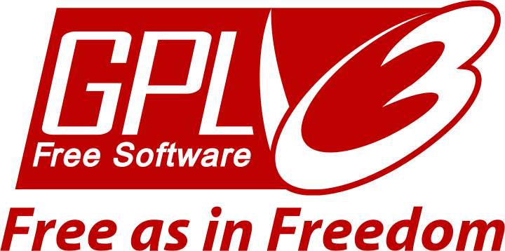

<div align="center"><a href="https://github.com/coignard/clippy">
  <picture>
    <source srcset="https://github.com/coignard/clippy/blob/main/assets/clippy.gif?raw=true">
    
  </picture>
</a>

Clippy, the Office Assistant, on the macOS desktop

[](https://github.com/coignard/clippy/actions)
[](LICENSE)
[](https://ko-fi.com/coignard)

</div>

## Install

```bash
git clone https://github.com/coignard/clippy
cd clippy
cargo xtask bundle
cp -R target/release/Clippy.app /Applications/
```

`cargo xtask bundle` prints where it put the app. With `--universal` it builds one that runs on both Apple silicon and Intel Macs, which needs both Rust targets:

```bash
rustup target add aarch64-apple-darwin x86_64-apple-darwin
cargo xtask bundle --universal
```

## Test

```bash
cargo test --workspace
```

Clippy itself and its plugins do not depend on macOS, so on other systems leave the shell out:

```bash
cargo test --workspace --exclude clippy-macos
```

## License



The [Clippy](https://github.com/coignard/clippy) source code is © 2026 René Coignard and licensed under the [GNU General Public License v3.0 or later](LICENSE).

The Clippit character, its animations and sounds, and the MS Sans Serif typeface are © Microsoft and are not covered by this license.

All tests in this repository were written with Claude Code and are not covered by the GPL license.
